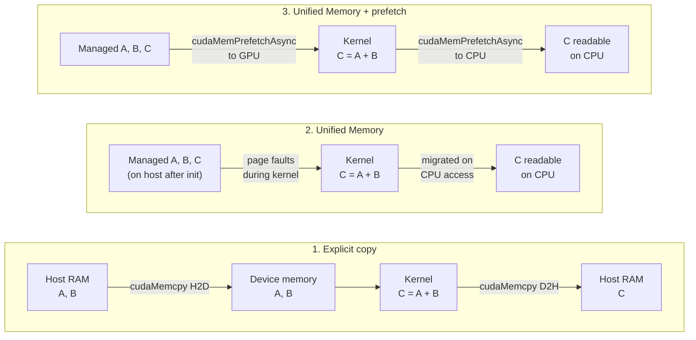
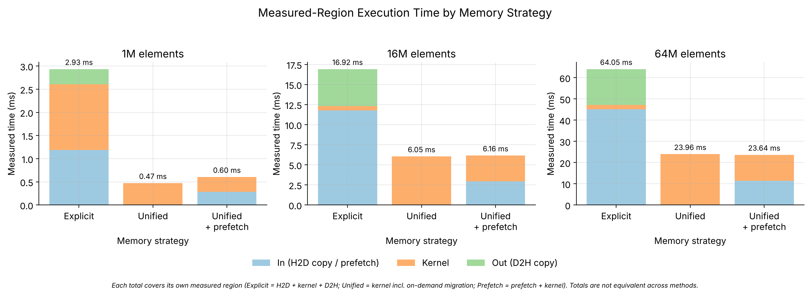
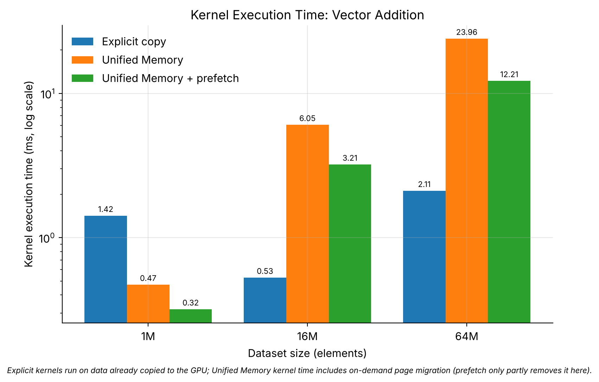
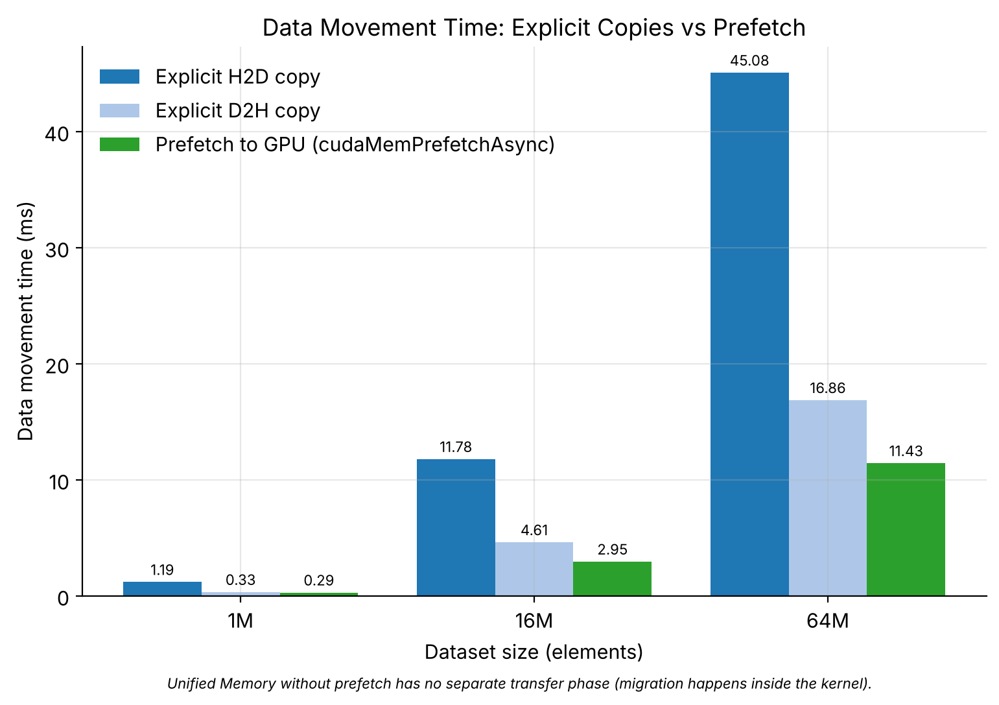
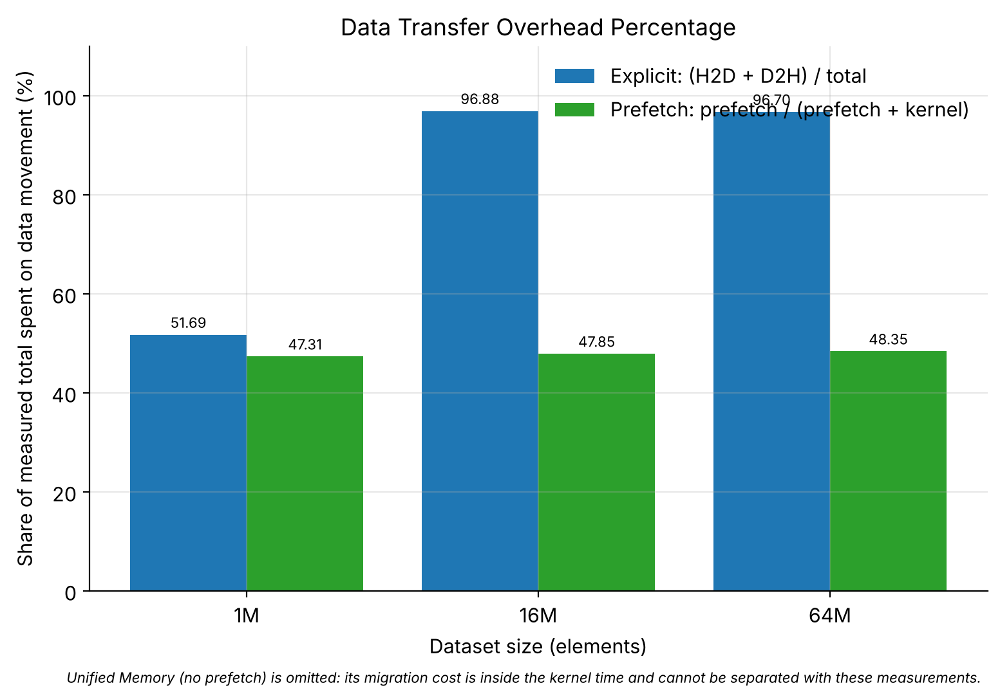

# Theme 6: Unified Memory vs Explicit Memory Copy

A CUDA experiment comparing **explicit memory copy**, **CUDA Unified Memory** and **Unified Memory with prefetching**, using vector addition at three dataset sizes (1M, 16M and 64M elements).


## Table of Contents

1. [Project Overview](#1-project-overview)
2. [Aim](#2-aim)
3. [Objectives](#3-objectives)
4. [Hardware Requirements](#4-hardware-requirements)
5. [Software Requirements](#5-software-requirements)
6. [Theoretical Background](#6-theoretical-background)
7. [Experimental Methodology](#7-experimental-methodology)
8. [System Architecture / Memory Transfer Flow](#8-system-architecture--memory-transfer-flow)
9. [Implementation Details](#9-implementation-details)
10. [Dataset Sizes](#10-dataset-sizes)
11. [Performance Metrics](#11-performance-metrics)
12. [Experimental Results](#12-experimental-results)
13. [Performance Comparison](#13-performance-comparison)
14. [Graphical Analysis](#14-graphical-analysis)
15. [Observations](#15-observations)
16. [Advantages and Limitations](#16-advantages-and-limitations)
17. [Real-World Applications](#17-real-world-applications)
18. [How to Compile and Execute](#18-how-to-compile-and-execute)
19. [Project Directory Structure](#19-project-directory-structure)
21. [Conclusion](#21-conclusion)

---

## 1. Project Overview

GPU kernels can only operate on data that the GPU can access. How that data reaches the GPU (explicit copies, on-demand page migration, or prefetching) changes total run time, often more than the computation itself. This project implements the same vector-addition kernel three times, differing only in memory management, and measures host-to-device (H2D) transfer, kernel, device-to-host (D2H) transfer and prefetch time.

| Approach | Key CUDA calls | Source |
|---|---|---|
| Explicit Memory Copy | `cudaMalloc`, `cudaMemcpy`, `cudaFree` | [`src/explicit.cu`](src/explicit.cu) |
| Unified Memory | `cudaMallocManaged` | [`src/unified.cu`](src/unified.cu) |
| Unified Memory + Prefetch | `cudaMallocManaged`, `cudaMemPrefetchAsync` | [`src/prefetch.cu`](src/prefetch.cu) |

## 2. Aim

To compare programmer-managed memory transfers (explicit copy) with CUDA Unified Memory and prefetching, and to measure how data-transfer overhead affects the execution time of GPU programs.

## 3. Objectives

1. Understand the difference between host memory and device memory.
2. Implement explicit memory copy with `cudaMalloc()` / `cudaMemcpy()`.
3. Implement Unified Memory with `cudaMallocManaged()`.
4. Implement Unified Memory prefetching with `cudaMemPrefetchAsync()`.
5. Measure H2D transfer, kernel and D2H transfer time.
6. Compare the three approaches for different dataset sizes.

## 4. Hardware Requirements

| Component | Requirement | Used in this experiment |
|---|---|---|
| GPU | NVIDIA CUDA-capable GPU with managed-memory support | NVIDIA GeForce RTX 5060 Ti (shown in terminal output) |
| CPU / RAM | Sufficient host RAM (about 0.8 GB for the 64M case, plus 0.8 GB of GPU memory) | Not recorded |
| Interconnect | PCIe link between CPU and GPU | Not recorded |

## 5. Software Requirements

| Software | Notes |
|---|---|
| OS | Windows with WSL2 Ubuntu (used in this experiment); native Linux also works |
| CUDA Toolkit + `nvcc` | CUDA 12.x or 13.x (the `cudaMemPrefetchAsync` signature difference is handled in `src/common.cuh`). RTX 50-series GPUs require a CUDA release that supports them. |
| Host compiler | `g++` compatible with your CUDA version |
| Python 3 + Matplotlib | For `scripts/plot_results.py` only |

## 6. Theoretical Background

### 6.1 Host Memory
System RAM attached to the CPU. Input data normally starts here.

### 6.2 Device Memory
Memory on the GPU board. Kernels read and write it at much higher bandwidth than the CPU-GPU link provides.

### 6.3 PCIe Communication
PCIe connects host and device. Explicit copies and page migrations both travel over this link, so its bandwidth bounds transfer time:

$$T_{transfer} \approx \frac{\text{bytes moved}}{\text{effective PCIe bandwidth}}$$

### 6.4 Explicit Memory Copy
The programmer allocates device buffers and moves data with `cudaMemcpy`. Three stages are visible and separately measurable: **H2D → kernel → D2H**.

### 6.5 Unified Memory
`cudaMallocManaged` returns one pointer valid on both CPU and GPU. The driver migrates pages as needed, which removes copy code from the program.

### 6.6 Page Migration
When the GPU touches a managed page that currently resides in host memory, a page fault occurs and the driver migrates the page. This is convenient but adds latency *inside the kernel*, because the faults are serviced while the kernel runs.

### 6.7 Unified Memory Prefetching
`cudaMemPrefetchAsync` asks the driver to migrate a range to a given processor ahead of time, in bulk, so the kernel is less likely to fault.

## 7. Experimental Methodology

The same kernel, `C[i] = A[i] + B[i]`, runs for every approach on `float` arrays. For each dataset size and approach, the program repeats the run (default 5 times, each with fresh allocations), averages the timings and verifies every output element.

**Approach 1: Explicit copy.** Allocate host and device buffers → copy A, B to the device → run kernel → copy C back → verify → free.

**Approach 2: Unified Memory.** `cudaMallocManaged` A, B, C → initialise on the CPU → run kernel → synchronise → verify → free.

**Approach 3: Unified Memory + prefetch.** `cudaMallocManaged` A, B, C → initialise on the CPU → prefetch A, B, C to the GPU → run kernel → prefetch C back to the CPU → verify → free.

Detailed timing boundaries are in [`docs/methodology.md`](docs/methodology.md).

## 8. System Architecture / Memory Transfer Flow



## 9. Implementation Details

| File | Purpose |
|---|---|
| [`src/common.cuh`](src/common.cuh) | Kernel, `CUDA_CHECK` error macro, CUDA-event timer, input initialisation, exact result verification, CSV writer, CUDA 12/13 prefetch wrapper |
| [`src/explicit.cu`](src/explicit.cu) | Approach 1 |
| [`src/unified.cu`](src/unified.cu) | Approach 2 |
| [`src/prefetch.cu`](src/prefetch.cu) | Approach 3 |
| [`scripts/plot_results.py`](scripts/plot_results.py) | Graph generation from `results/results.csv` |
| [`Makefile`](Makefile) | Build, run and plot targets |

Design points:

- **Error checking:** every CUDA call is wrapped in `CUDA_CHECK`, which prints file, line and error string and exits.
- **Correctness:** inputs are small integers stored as `float`, so sums are exact and every element is compared with exact equality.
- **Timing:** stage times use CUDA events; an additional host wall-clock *end-to-end* time covers first transfer/launch until the result is readable on the CPU.
- **Warm-up:** one dummy launch initialises the CUDA context before measurement, so start-up cost is not charged to the first dataset.
- **Explicit copy uses pageable host memory** (`malloc`), the common baseline. Pinned memory would make explicit copies faster.

## 10. Dataset Sizes

| Label | Elements | Bytes per array (float) | Bytes moved by kernel (A, B read, C write) |
|---|---|---|---|
| Small (1M) | 1,000,000 | 4 MB | 12 MB |
| Medium (16M) | 16,000,000 | 64 MB | 192 MB |
| Large (64M) | 64,000,000 | 256 MB | 768 MB |

## 11. Performance Metrics

| Metric | Meaning |
|---|---|
| H2D time | Copy of A and B from host to device (explicit only) |
| Kernel time | GPU execution time of the vector addition (for Unified Memory, includes on-demand migration) |
| D2H time | Copy of C from device to host (explicit only) |
| Prefetch time | `cudaMemPrefetchAsync` of A, B, C to the GPU (prefetch version only) |
| Total (measured region) | Sum of the stages measured for that approach; **definition differs per approach** (see below) |
| End-to-end | Host wall-clock, same boundary for all approaches (produced by the sources in `src/`) |
| Correctness | Every output element equals `A[i] + B[i]` |

$$\text{Transfer overhead (\%)} = \frac{T_{H2D} + T_{D2H}}{T_{total}} \times 100$$

| Approach | Measured-region Total |
|---|---|
| Explicit | H2D + kernel + D2H |
| Unified | kernel only (page migration happens inside it) |
| Prefetch | prefetch + kernel (return prefetch excluded) |

> These totals cover different work and **must not be ranked against each other as if equivalent.** See [Section 20](#20-evidence-provenance-and-known-limitations).

## 12. Experimental Results

Source: [`results/results.csv`](results/results.csv) (all values in ms; GPU: NVIDIA GeForce RTX 5060 Ti). Provenance is described in [Section 20](#20-evidence-provenance-and-known-limitations).

| Dataset | Method | H2D | Kernel | D2H | Prefetch | Total (measured region) | End-to-end | Correct |
|---|---|---:|---:|---:|---:|---:|---|:---:|
| 1M | Explicit | 1.18746 | 1.41750 | 0.329054 | – | 2.93402 | not measured | PASS |
| 1M | Unified | – | 0.471104 | – | – | 0.471104 | not measured | PASS |
| 1M | Prefetch | – | 0.318276 | – | 0.285731 | 0.604007 | not measured | PASS |
| 16M | Explicit | 11.7825 | 0.527456 | 4.61343 | – | 16.9234 | not measured | PASS |
| 16M | Unified | – | 6.05136 | – | – | 6.05136 | not measured | PASS |
| 16M | Prefetch | – | 3.21287 | – | 2.94781 | 6.16068 | not measured | PASS |
| 64M | Explicit | 45.07582 | 2.11104 | 16.85957 | – | 64.04642 | not measured | PASS |
| 64M | Unified | – | 23.95923 | – | – | 23.95923 | not measured | PASS |
| 64M | Prefetch | – | 12.20841 | – | 11.42763 | 23.63604 | not measured | PASS |

"–" means the stage does not exist as a separate phase for that approach. The 1M explicit kernel time (1.4175 ms) is anomalously high; see Section 20.

## 13. Performance Comparison

**Like-for-like quantities (supported by the data)**

| Dataset | Explicit kernel | Unified kernel | Prefetch kernel | Unified ÷ Explicit kernel | Prefetch ÷ Explicit kernel |
|---|---:|---:|---:|---:|---:|
| 16M | 0.527 ms | 6.051 ms | 3.213 ms | 11.5× | 6.1× |
| 64M | 2.111 ms | 23.959 ms | 12.208 ms | 11.4× | 5.8× |

**Data-movement share of the measured total**

| Dataset | Explicit: (H2D + D2H) / total | Prefetch: prefetch / total |
|---|---:|---:|
| 1M | 51.7 % | 47.3 % |
| 16M | 96.9 % | 47.8 % |
| 64M | 96.7 % | 48.3 % |

**Derived transfer rates for the explicit copies** (4-byte elements assumed):

| Dataset | H2D (2 arrays) | D2H (1 array) | Kernel memory throughput |
|---|---:|---:|---:|
| 16M | 10.9 GB/s | 13.9 GB/s | 364 GB/s |
| 64M | 11.4 GB/s | 15.2 GB/s | 364 GB/s |

The 16M and 64M kernel throughputs agree (364 GB/s), which supports the 16M kernel/D2H values used in this repository (see Section 20).

## 14. Graphical Analysis

### 14.1 Measured-region time by strategy


Stacked bars show each approach's measured stages; each bar's total covers a different region.

### 14.2 Kernel time (like-for-like)


### 14.3 Data-movement time


### 14.4 Transfer-overhead percentage


Graphs are regenerated with `make plot`. If `results.csv` contains real `EndToEnd_ms` values, an additional `end_to_end_time.png` (the like-for-like total) is produced.

## 15. Observations

1. **Explicit copy is transfer-dominated at large sizes.** At 16M and 64M elements about 97 % of the explicit measured time is H2D + D2H copying; the kernel is a small fraction.
2. **The explicit kernel is the fastest kernel.** With data already in device memory it sustains about 364 GB/s at 16M and 64M.
3. **Unified Memory moves the cost into the kernel.** Unified kernel time is about 11× the explicit kernel at 16M and 64M, consistent with on-demand page migration during execution.
4. **Prefetching roughly halves the Unified Memory kernel time** (6.05 → 3.21 ms at 16M; 23.96 → 12.21 ms at 64M) but the kernel is still about 6× slower than the explicit kernel, so migration cost was not fully eliminated in these runs. The cause was not profiled.
5. **Prefetching is faster than explicit H2D copying here** (11.4 vs 45.1 ms at 64M). The explicit version copies from pageable host memory, so part of this gap may reflect pageable-memory staging rather than Unified Memory itself. Not tested with pinned memory.
6. **The measured totals do not establish a winner.** Unified/prefetch totals omit host initialisation and returning the result to the CPU; the explicit total includes its D2H copy. A like-for-like ranking requires the `EndToEnd_ms` column (Section 20).
7. **All nine recorded results passed verification.**

## 16. Advantages and Limitations

| Approach | Advantages | Limitations |
|---|---|---|
| Explicit copy | Full control; separately measurable H2D/D2H; kernel runs on resident data | More code; manual buffers; copy time can dominate |
| Unified Memory | Simplest code; one pointer for CPU and GPU; supports oversubscription on supported systems | Page-fault migration inside the kernel; transfer cost hidden in kernel time; behaviour is platform-dependent (WSL2 has more limited managed-memory support than native Linux) |
| Unified + prefetch | Bulk migration before the kernel; less fault latency; more control | Requires knowing access patterns; extra calls; benefit not guaranteed (kernel stayed slower than explicit here) |

## 17. Real-World Applications

| Domain | Relevance |
|---|---|
| Deep learning | Large datasets and model parameters must reach the GPU efficiently; prefetching and pinned copies hide transfer latency |
| Scientific computing / simulation | Working sets can exceed device memory; Unified Memory simplifies porting |
| Image and video processing | Streams of frames require overlapping transfer and compute |
| Large-scale data processing | Data movement often costs more than computation, so placement strategy decides throughput |
| GPU-accelerated engineering applications | Rapid development with Unified Memory, then explicit tuning of hot paths |

## 18. How to Compile and Execute

**Prerequisites:** CUDA Toolkit (`nvcc` on `PATH`), `make`, Python 3 with Matplotlib (`pip install matplotlib`).

```bash
# 1. Build the three executables into build/
make

# 2. Run all three experiments and write results/results.csv (default 5 runs each)
make run
#    more repetitions:  make run RUNS=10

# 3. Regenerate graphs in results/graphs/
make plot
```

If `-arch=native` is not supported by your `nvcc`, set the architecture explicitly:

```bash
make ARCH=-arch=sm_120        # example: RTX 50-series
```

Manual compilation and execution:

```bash
nvcc -O2 -std=c++14 -arch=native -o build/explicit src/explicit.cu
nvcc -O2 -std=c++14 -arch=native -o build/unified  src/unified.cu
nvcc -O2 -std=c++14 -arch=native -o build/prefetch src/prefetch.cu
./build/explicit results/results.csv 5     # arguments: [csv path] [runs]
```

> `make run` **overwrites** `results/results.csv`. The committed CSV comes from an earlier run (see Section 20); keep a copy if you want to preserve it.

## 19. Project Directory Structure

```text
Theme6_Unified_Memory/
├── README.md
├── LICENSE
├── .gitignore
├── Makefile
├── src/
│   ├── common.cuh
│   ├── explicit.cu
│   ├── unified.cu
│   └── prefetch.cu
├── scripts/
│   └── plot_results.py
├── results/
│   ├── results.csv
│   └── graphs/
│       ├── total_time.png
│       ├── kernel_time.png
│       ├── transfer_time.png
│       └── transfer_overhead.png
├── screenshots/
│   ├── terminal/
│   │   ├── make_run_and_results_csv_RTX5060Ti.png
│   │   ├── run_unified_memory_experiment_earlier_build.png
│   │   └── first_run_csv_and_plot_script.png
│   ├── performance_graphs/
│   │   └── legacy_total_vs_kernel_only_graph.png
│   └── experiment/
│       └── assignment_brief_theme6.png
└── docs/
    ├── experiment_theory.md
    ├── methodology.md
    └── data_provenance.md
```

## 20. Conclusion

The experiment shows that memory management strategy strongly affects GPU program performance. With explicit copies, about 97 % of the measured time at 16M and 64M elements is spent moving data, while the kernel itself runs at roughly 364 GB/s. Unified Memory removes the copy code but transfers cost into the kernel, which ran about 11× slower than the explicit kernel at those sizes. Prefetching halves that penalty without eliminating it. Because the three measured totals cover different regions, the results do not by themselves rank the approaches; a like-for-like comparison requires the end-to-end measurement included in the provided sources. The appropriate choice depends on dataset size, access pattern, hardware and the platform's managed-memory support.
